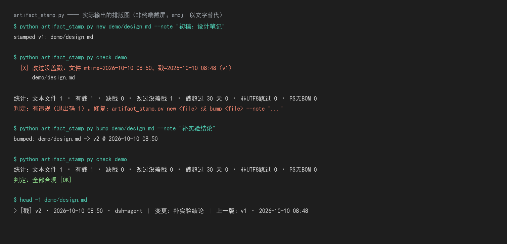

> 🕒 v2 · 2026-10-10 08:52 · dsh-agent ｜ 变更：加实测演示图（docs/demo.png） ｜ 上一版：v1 · 2026-10-10 08:50

# dsh-artifact-stamp

给**文本产物**盖「时间戳 + 版本号」的**行内版本戳**，并提供一个可当 CI 关卡用的体检命令。

一句话：**给文档做一版手工简化的 git** —— 但戳写在文件**自己身上**，人眼一眼可见，机器也能解析。

## 为什么会有这个

当 agent 频繁改写 `.md`（笔记、技能、README、实验记录）时，会遇到一个问题：

- **git 不适合**：文档是持续追加的，每次改动都 commit 太重；而且看历史要跳出文件本身
- **不管也不行**：你打开一个文档，**不知道它什么时候写的、这一版改了什么、上一版长什么样**

所以约定一条：**每个文本产物的正文最前面，有一行可读、可解析的戳**。

```
> 🕒 v2 · 2026-10-10 08:50 · dsh-agent ｜ 变更：补实验结论 ｜ 上一版：v1 · 2026-10-10 08:48
```

> 🔴 **没有脚本守的约定一定会漂移。** 所以这条约定配了工具 + 体检命令：
> `check` 会比对「戳里的时间」与「文件 mtime」，**改过却没盖戳 → 退出码 1**。

## 装

本仓库根目录就是一个 **DSH 技能**，clone 后放进用户级技能根即可：

```bash
git clone https://github.com/yanggaihao5-sys/dsh-artifact-stamp.git
cp -r dsh-artifact-stamp ~/.dsh/skills/artifact-stamp
```

Windows（PowerShell）：

```powershell
git clone https://github.com/yanggaihao5-sys/dsh-artifact-stamp.git
Copy-Item -Recurse dsh-artifact-stamp "$env:USERPROFILE\.dsh\skills\artifact-stamp"
```

只用命令行也行（**纯标准库、无网络、可离线跑**）：

```bash
python scripts/artifact_stamp.py new  <file> --note "初稿"
python scripts/artifact_stamp.py bump <file> --note "补数据"
python scripts/artifact_stamp.py show <file>
python scripts/artifact_stamp.py check <路径...> [--days 30] [--include-code]
python scripts/artifact_stamp.py strip <路径...> --dry-run
```

| 子命令 | 干什么 |
|---|---|
| `new` | 新建时盖 v1（已有戳则不覆盖） |
| `bump` | 改完后升版 v1→v2；**note 没变就不升版**（除非 `--force`） |
| `show` | 看当前戳 |
| `check` | 体检：缺戳 / **改过没盖戳** / 戳过期；**退出码 1 = 有违规** |
| `strip` | 回滚：一键删掉所有戳行（`--dry-run` 先预览） |

## 实测演示



> 上图是 `demo/` 里**真实跑出来的输出**的排版图（不是终端截屏；emoji 以文字替代）。

```
$ python scripts/artifact_stamp.py new demo/design.md --note "初稿：设计笔记"
stamped v1: demo/design.md

# 过了 95 秒后改了内容，但忘了盖戳：
$ python scripts/artifact_stamp.py check demo
  ✗ 改过没盖戳：文件 mtime=2026-10-10 08:50，戳=2026-10-10 08:48（v1）
      demo/design.md

统计：文本文件 1 · 有戳 1 · 缺戳 0 · 改过没盖戳 1 · 戳超过 30 天 0 · 非UTF8跳过 0 · PS无BOM 0
判定：有违规（退出码 1）。修复：`artifact_stamp.py new <file>` 或 `bump <file> --note "..."`

$ python scripts/artifact_stamp.py bump demo/design.md --note "补实验结论"
bumped: demo/design.md -> v2 @ 2026-10-10 08:50

$ python scripts/artifact_stamp.py check demo
统计：文本文件 1 · 有戳 1 · 缺戳 0 · 改过没盖戳 0 · 戳超过 30 天 0 · 非UTF8跳过 0 · PS无BOM 0
判定：全部合规 ✅
```

盖完的正文长这样：

```
> 🕒 v2 · 2026-10-10 08:50 · dsh-agent ｜ 变更：补实验结论 ｜ 上一版：v1 · 2026-10-10 08:48

# 设计笔记

第一版。

补了一段实验结论。
```

## 支持哪些文件类型

戳必须写成该文件类型合法的注释，否则会把源码写坏。已内建映射：

| 扩展名 | 前缀 |
|---|---|
| `.md` `.markdown` `.txt` `.rst` `.org` | `> ` |
| `.py` `.ps1` `.sh` `.yaml` `.toml` `.ini` `.r` `.jl` `.m` … | `# ` |
| `.js` `.ts` `.c` `.cpp` `.java` `.go` `.rs` … | `// ` |
| `.tex` `.bib` `.sty` `.cls` | `% ` |
| `.vbs` `.vba` `.bas` | `' ` |

**不认识的类型直接拒绝盖戳并报错**（而不是硬插一行把文件弄坏）。

## 🔴 已知限制（先说清楚）

1. **90 秒分辨率**：戳只有**分钟精度**，而 mtime 是秒精度。所以**盖戳后 90 秒内的改动 `check` 检测不到**（默认 `--tolerance 90` 就是为了吸收这个偏差）。
   ⚠️ **`--tolerance 0` 不是可用设置**——它会对每个刚盖过戳的文件都报漂移。想要更灵敏只能把戳精度改成秒。
2. **不是 git 的替代品**：它只记「**什么时候、改了什么（一句话）**」，**不存差异、不能回滚内容**。真正的版本控制仍然用 git。
3. **不改文件编码**：原文件带 UTF-8 BOM 就保留，没有就不加。**唯一例外**是给 `.ps1` 写进非 ASCII 时会自动补 BOM（Windows PowerShell 5.1 会把无 BOM 的脚本按 GBK 读 → 中文乱码/语法错）。
4. **保护 YAML frontmatter**：`SKILL.md` 这类带 `---` 头的文件，戳插在 frontmatter **之后**。
5. **保护 shebang**：`.py` 的 `#!` 与 PEP-263 编码行永远留在最前（早期版本曾把戳插到第 1 行，导致 `./x.py` 直接执行失效）。
6. **体检默认跳过** `.git` / `node_modules` / `__pycache__` / `backups` / `_归档`；默认不检查 `.json`（数据文件不该盖戳）。

## License

MIT
